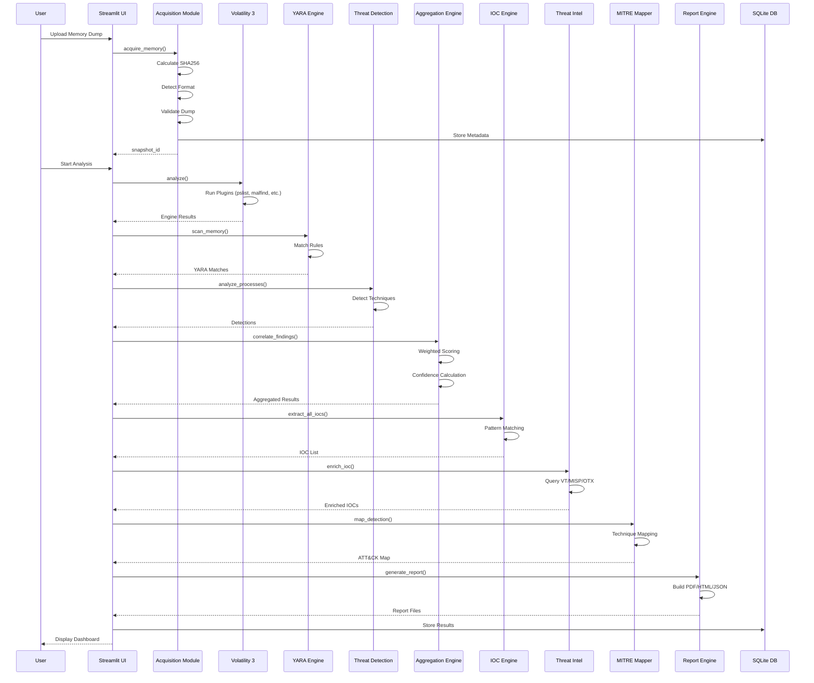
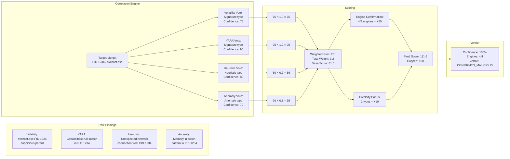
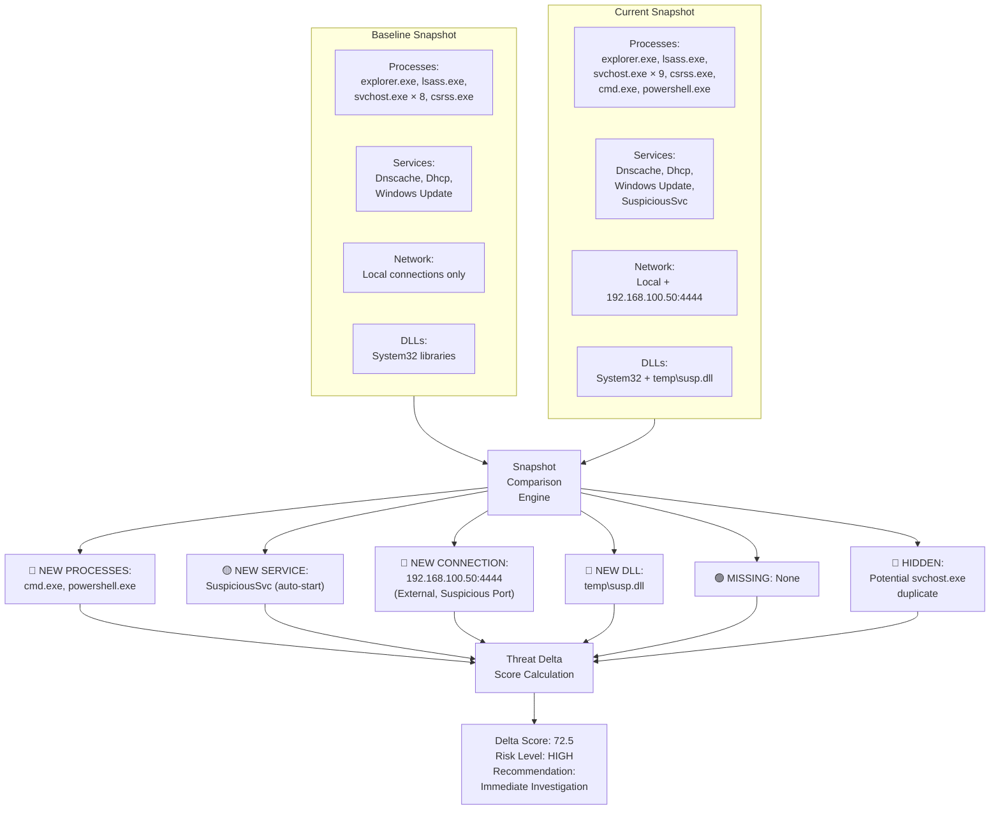
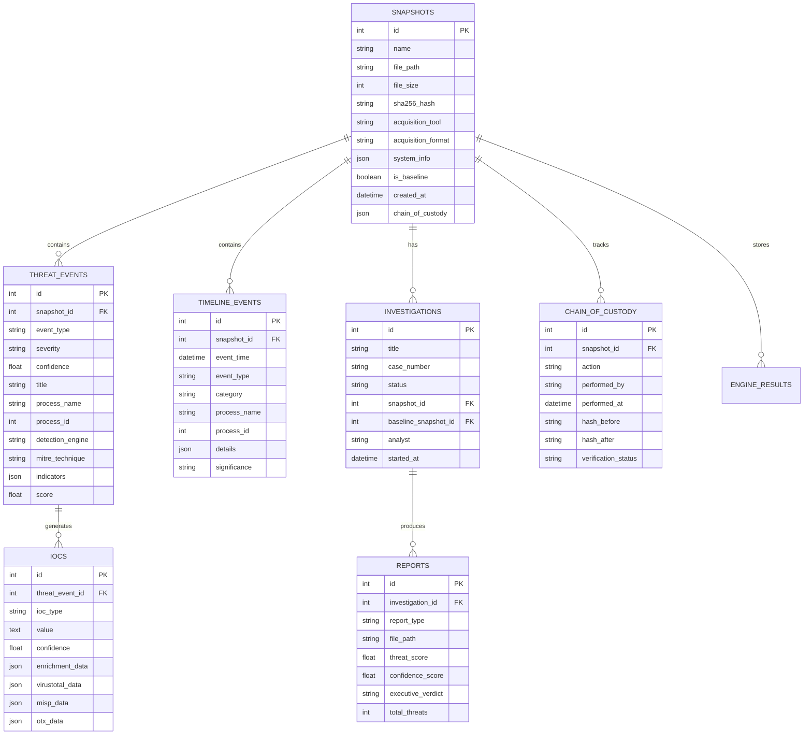

# Enterprise Memory Forensics Platform - Workflow Diagram

## Complete DFIR Workflow

```mermaid
flowchart TB
    subgraph ACQUISITION["📁 1. Memory Acquisition"]
        A1["Memory Dump Upload<br/>RAW / LiME / AFF4 / VMEM"] --> A2["Format Detection<br/>& Validation"]
        A2 --> A3["SHA256 Hash<br/>Calculation"]
        A3 --> A4["Metadata Extraction<br/>OS / Profile / Arch"]
        A4 --> A5["Chain of Custody<br/>Log Entry"]
        A5 --> A6[("SQLite Database<br/>Snapshot Storage")]
    end

    subgraph ANALYSIS["🔬 2. Multi-Engine Analysis"]
        A6 --> V3["Volatility 3<br/>pslist / psscan / pstree<br/>dlllist / malfind / netscan<br/>svcscan / callbacks / driverirp<br/>modscan / registry.hivelist"]
        A6 --> YARA["YARA Engine<br/>Malware Rules<br/>Shellcode Rules<br/>Cobalt Strike Rules"]
        A6 --> MPF["MemProcFS<br/>Process Analysis"]
        A6 --> REK["Rekall<br/>Memory Analysis"]
    
        V3 --> MERGE["🔄 Result<br/>Aggregation"]
        YARA --> MERGE
        MPF --> MERGE
        REK --> MERGE
    end

    subgraph COMPARISON["🔄 3. Snapshot Comparison"]
        MERGE --> COMP["Comparison Engine<br/>Baseline vs Current"]
        BASE[("Baseline<br/>Snapshot")] --> COMP
        COMP --> COMP_DETECT["Detect Changes:<br/>• New/Missing/Hidden Processes<br/>• DLL Changes<br/>• New Services/Drivers<br/>• Network Changes<br/>• Registry Changes"]
        COMP_DETECT --> DELTA["Threat Delta Score<br/>Calculation"]
    end

    subgraph DETECTION["🎯 4. Threat Detection"]
        MERGE --> TD["Threat Detection Engine"]
        DELTA --> TD
        
        TD --> T1["Process Hollowing<br/>T1055.012"]
        TD --> T2["DLL Injection<br/>T1055.001"]
        TD --> T3["Reflective DLL<br/>T1620"]
        TD --> T4["Doppelgänging<br/>T1055"]
        TD --> T5["AtomBombing<br/>T1055"]
        TD --> T6["Process Herpaderping<br/>T1055"]
        TD --> T7["Rootkit Detection<br/>T1014"]
        TD --> T8["Parent PID Spoofing<br/>T1134.004"]
        TD --> T9["Command Obfuscation<br/>T1027"]
        TD --> T10["Fileless Malware<br/>T1059"]
        TD --> T11["PowerShell Abuse<br/>T1059.001"]
        TD --> T12["Credential Dumping<br/>T1003"]
        TD --> T13["LSASS Access<br/>T1003.001"]
        TD --> T14["Persistence<br/>T1547"]
    end

    subgraph AGGREGATION["⚖️ 5. VT-Style Aggregation"]
        T1 --> AGG
        T2 --> AGG
        T3 --> AGG
        T4 --> AGG
        T5 --> AGG
        T6 --> AGG
        T7 --> AGG
        T8 --> AGG
        T9 --> AGG
        T10 --> AGG
        T11 --> AGG
        T12 --> AGG
        T13 --> AGG
        T14 --> AGG
        
        AGG["Aggregation Engine<br/>Multi-Engine Correlation"]
        
        AGG --> RULE1["Rule: Min 2 Engine<br/>Confirmations"]
        RULE1 --> RULE2["Signature Weight: 1.0<br/>Heuristic Weight: 0.7<br/>Anomaly Weight: 0.5"]
        RULE2 --> CONF["Confidence Score<br/>Calculation"]
    end

    subgraph VERDICT["📊 6. Confidence Verdict"]
        CONF --> VER["Verdict Assignment"]
        
        VER --> V_MAL["≥ 90: Confirmed<br/>Malicious"]
        VER --> V_HIGH["≥ 70: Highly<br/>Suspicious"]
        VER --> V_SUSP["≥ 50: Suspicious"]
        VER --> V_POS["≥ 30: Possibly<br/>Suspicious"]
        VER --> V_BEN["< 30: Likely<br/>Benign"]
    end

    subgraph IOC["🎯 7. IOC Extraction"]
        AGG --> IOC_ENG["IOC Engine"]
        
        IOC_ENG --> IOC_IP["IP Addresses"]
        IOC_ENG --> IOC_DOM["Domains"]
        IOC_ENG --> IOC_URL["URLs"]
        IOC_ENG --> IOC_HASH["File Hashes"]
        IOC_ENG --> IOC_MUT["Mutexes"]
        IOC_ENG --> IOC_REG["Registry Keys"]
        IOC_ENG --> IOC_DLL["DLLs"]
        IOC_ENG --> IOC_PROC["Processes"]
        
        IOC_IP --> IOC_OUT["Multi-Format Export:<br/>JSON / CSV / PDF / STIX 2.1 / OpenIOC"]
        IOC_DOM --> IOC_OUT
        IOC_URL --> IOC_OUT
        IOC_HASH --> IOC_OUT
        IOC_MUT --> IOC_OUT
        IOC_REG --> IOC_OUT
        IOC_DLL --> IOC_OUT
        IOC_PROC --> IOC_OUT
    end

    subgraph INTEL["🌐 8. Threat Intelligence"]
        IOC_IP --> VT["VirusTotal API"]
        IOC_DOM --> VT
        IOC_HASH --> VT
        
        IOC_IP --> MISP["MISP"]
        IOC_HASH --> MISP
        
        IOC_IP --> OTX["AlienVault OTX"]
        IOC_DOM --> OTX
        IOC_HASH --> OTX
        
        VT --> ENRICH["Enriched IOCs:<br/>• Detection Ratios<br/>• Community Scores<br/>• Tags<br/>• First/Last Seen"]
        MISP --> ENRICH
        OTX --> ENRICH
    end

    subgraph MITRE["🎯 9. MITRE ATT&CK"]
        VER --> MITRE_MAP["MITRE ATT&CK<br/>Mapping Engine"]
        
        MITRE_MAP --> MT1["T1055 Process Injection"]
        MITRE_MAP --> MT2["T1055.012 Process Hollowing"]
        MITRE_MAP --> MT3["T1055.001 DLL Injection"]
        MITRE_MAP --> MT4["T1620 Reflective Code Loading"]
        MITRE_MAP --> MT5["T1014 Rootkit"]
        MITRE_MAP --> MT6["T1003.001 LSASS Memory"]
        MITRE_MAP --> MT7["T1056.001 Keylogging"]
        MITRE_MAP --> MT8["T1071 Application Layer Protocol"]
        
        MT1 --> HEAT["ATT&CK Heatmap<br/>Generation"]
        MT2 --> HEAT
        MT3 --> HEAT
        MT4 --> HEAT
        MT5 --> HEAT
        MT6 --> HEAT
        MT7 --> HEAT
        MT8 --> HEAT
        
        HEAT --> NAV["Navigator Layer<br/>Export"]
    end

    subgraph TIMELINE["⏱️ 10. Timeline Reconstruction"]
        AGG --> TL["Timeline Engine"]
        
        TL --> TL1["Process Creation<br/>Events"]
        TL --> TL2["DLL Loading<br/>Events"]
        TL --> TL3["Network Activity<br/>Events"]
        TL --> TL4["Registry<br/>Events"]
        TL --> TL5["Service Creation<br/>Events"]
        TL --> TL6["Driver Loading<br/>Events"]
        TL --> TL7["Memory Injection<br/>Events"]
        
        TL1 --> TL_MERGE["Chronological<br/>Merge"]
        TL2 --> TL_MERGE
        TL3 --> TL_MERGE
        TL4 --> TL_MERGE
        TL5 --> TL_MERGE
        TL6 --> TL_MERGE
        TL7 --> TL_MERGE
    end

    subgraph TREE["🌳 11. Process Tree"]
        AGG --> PT["Process Tree<br/>Builder"]
        
        PT --> PT1["Parent-Child<br/>Relationships"]
        PT1 --> PT2["Suspicious Chain<br/>Detection"]
        PT1 --> PT3["Injection Target<br/>Identification"]
        PT1 --> PT4["Hidden Process<br/>Detection"]
        
        PT2 --> PLOT["Interactive Plotly<br/>Visualization"]
        PT3 --> PLOT
        PT4 --> PLOT
    end

    subgraph REPORT["📑 12. Report Generation"]
        ENRICH --> REP["Report Engine"]
        HEAT --> REP
        TL_MERGE --> REP
        PLOT --> REP
        
        REP --> R_EXEC["Executive Summary"]
        REP --> R_THREAT["Threat Findings"]
        REP --> R_IOC["IOC List"]
        REP --> R_MITRE["MITRE Mapping"]
        REP --> R_TL["Timeline"]
        REP --> R_COMP["Comparison Results"]
        REP --> R_REC["Recommendations"]
        
        R_EXEC --> R_OUT["Output Formats:<br/>PDF / HTML / JSON"]
        R_THREAT --> R_OUT
        R_IOC --> R_OUT
        R_MITRE --> R_OUT
        R_TL --> R_OUT
        R_COMP --> R_OUT
        R_REC --> R_OUT
    end

    subgraph ANALYTICS["📈 13. Historical Analytics"]
        R_OUT --> HIST["Analytics Engine"]
        
        HIST --> H1["Threat Score<br/>Trends"]
        HIST --> H2["IOC Discovery<br/>Trends"]
        HIST --> H3["Detection<br/>Trends"]
        HIST --> H4["Engine Agreement<br/>Rates"]
        
        H1 --> DASH["Dashboard<br/>Metrics"]
        H2 --> DASH
        H3 --> DASH
        H4 --> DASH
    end

    subgraph DB[("🗄️ SQLite Database")]
        direction TB
        DB1["snapshots"]
        DB2["threat_events"]
        DB3["iocs"]
        DB4["timeline_events"]
        DB5["reports"]
        DB6["investigations"]
        DB7["chain_of_custody"]
        DB8["engine_results"]
        DB9["historical_metrics"]
    end

    A6 -.-> DB
    AGG -.-> DB
    IOC_OUT -.-> DB
    ENRICH -.-> DB
    R_OUT -.-> DB
    DASH -.-> DB
```

## Data Flow Diagram



## Engine Correlation Flow



## Snapshot Comparison Flow



## Database Schema Overview

